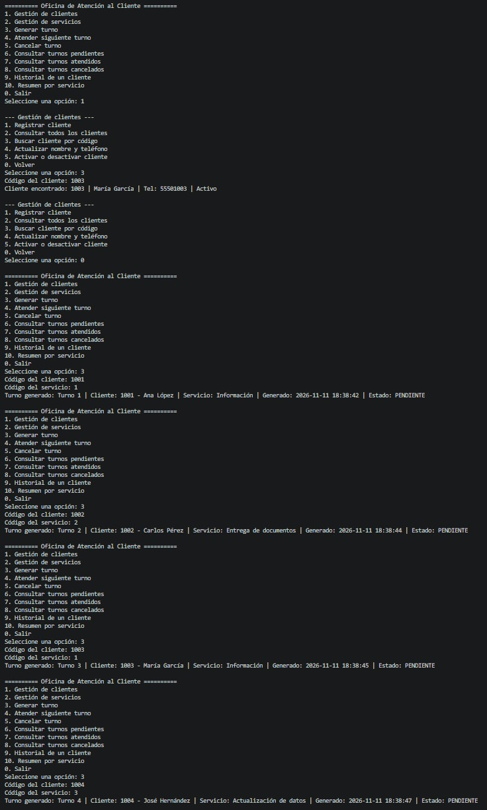
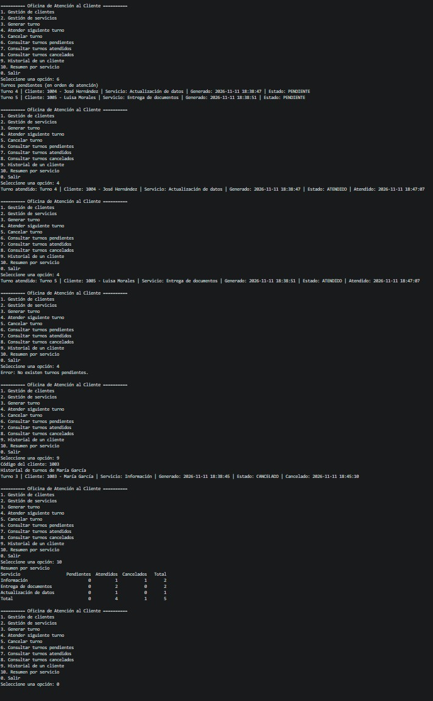
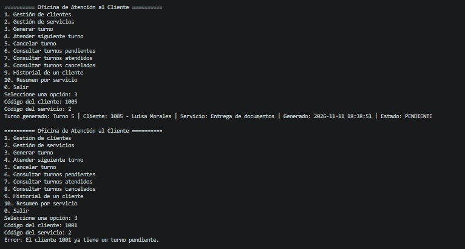
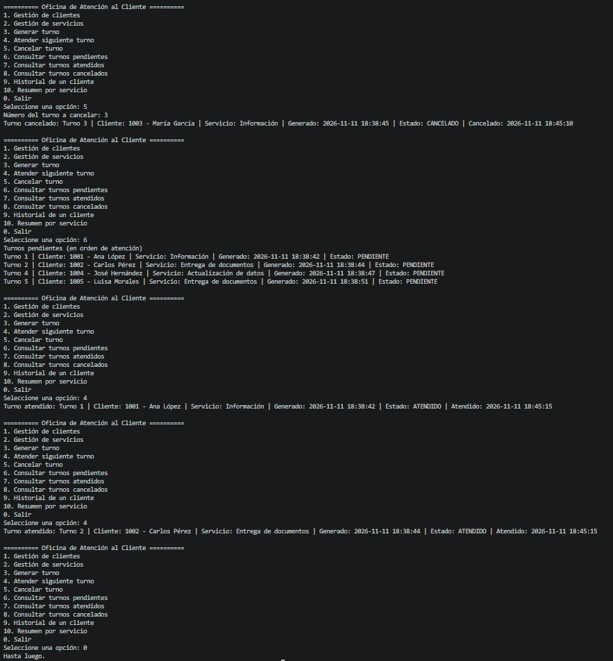

# Informe de la secuencia de comprobación

Sistema de Atención de Turnos — Manuel Alexander Osorio Aldana, carné 0909 23 11873.

La secuencia se ejecutó comenzando con los datos iniciales (5 clientes, 3 servicios y ningún turno). El paso 6 se realizó cerrando el programa con la opción 0 y volviéndolo a abrir.

## Resultados

| Paso | Operación | Resultado esperado | Resultado obtenido |
|---|---|---|---|
| 1 | Buscar al cliente 1003 mediante el BST | Mostrar a María García | Cumple |
| 2 | Generar turnos 1001/1, 1002/2, 1003/1, 1004/3, 1005/2 | Turnos 1, 2, 3, 4 y 5 | Cumple |
| 3 | Otro turno para el cliente 1001 | Rechazado por turno pendiente | Cumple |
| 4 | Cancelar el turno 3 | Cola: 1, 2, 4 y 5 | Cumple |
| 5 | Atender dos turnos | Primero el 1 y después el 2 | Cumple |
| 6 | Cerrar y volver a abrir | Estados conservados; cola con 4 y 5 | Cumple |
| 7 | Atender los turnos restantes | Primero el 4 y después el 5 | Cumple |
| 8 | Intentar atender nuevamente | Informa que no hay turnos pendientes | Cumple |
| 9 | Historial del cliente 1003 | Turno 3 cancelado | Cumple |
| 10 | Resumen por servicio | Resumen esperado | Cumple |

## Salida de consola

### Pasos 1 a 5 (primera ejecución)

```
Paso 1
Cliente encontrado: 1003 | María García | Tel: 55501003 | Activo

Paso 2
Turno generado: Turno 1 | Cliente: 1001 - Ana López | Servicio: Información | Generado: 2026-10-31 16:42:40 | Estado: PENDIENTE
Turno generado: Turno 2 | Cliente: 1002 - Carlos Pérez | Servicio: Entrega de documentos | Generado: 2026-10-31 16:42:40 | Estado: PENDIENTE
Turno generado: Turno 3 | Cliente: 1003 - María García | Servicio: Información | Generado: 2026-10-31 16:42:40 | Estado: PENDIENTE
Turno generado: Turno 4 | Cliente: 1004 - José Hernández | Servicio: Actualización de datos | Generado: 2026-10-31 16:42:40 | Estado: PENDIENTE
Turno generado: Turno 5 | Cliente: 1005 - Luisa Morales | Servicio: Entrega de documentos | Generado: 2026-10-31 16:42:40 | Estado: PENDIENTE

Paso 3
Error: El cliente 1001 ya tiene un turno pendiente.

Paso 4
Turno cancelado: Turno 3 | Cliente: 1003 - María García | Servicio: Información | Generado: 2026-10-31 16:42:40 | Estado: CANCELADO | Cancelado: 2026-10-31 16:42:40
Turnos pendientes (en orden de atención)
Turno 1 | Cliente: 1001 - Ana López | Servicio: Información | ...
Turno 2 | Cliente: 1002 - Carlos Pérez | Servicio: Entrega de documentos | ...
Turno 4 | Cliente: 1004 - José Hernández | Servicio: Actualización de datos | ...
Turno 5 | Cliente: 1005 - Luisa Morales | Servicio: Entrega de documentos | ...

Paso 5
Turno atendido: Turno 1 | Cliente: 1001 - Ana López | Servicio: Información | Generado: 2026-10-31 16:42:40 | Estado: ATENDIDO | Atendido: 2026-10-31 16:42:40
Turno atendido: Turno 2 | Cliente: 1002 - Carlos Pérez | Servicio: Entrega de documentos | Generado: 2026-10-31 16:42:40 | Estado: ATENDIDO | Atendido: 2026-10-31 16:42:40
```

### Pasos 6 a 10 (programa reabierto)

```
Paso 6 (cola reconstruida)
Turnos pendientes (en orden de atención)
Turno 4 | Cliente: 1004 - José Hernández | Servicio: Actualización de datos | ...
Turno 5 | Cliente: 1005 - Luisa Morales | Servicio: Entrega de documentos | ...

Paso 7
Turno atendido: Turno 4 | Cliente: 1004 - José Hernández | Servicio: Actualización de datos | ... | Estado: ATENDIDO | ...
Turno atendido: Turno 5 | Cliente: 1005 - Luisa Morales | Servicio: Entrega de documentos | ... | Estado: ATENDIDO | ...

Paso 8
Error: No existen turnos pendientes.

Paso 9
Historial de turnos de María García
Turno 3 | Cliente: 1003 - María García | Servicio: Información | ... | Estado: CANCELADO | Cancelado: 2026-10-31 16:42:40

Paso 10
Resumen por servicio
Servicio                   Pendientes  Atendidos  Cancelados   Total
Información                         0          1           1       2
Entrega de documentos               0          2           0       2
Actualización de datos              0          1           0       1
Total                               0          4           1       5
```

## Capturas principales







